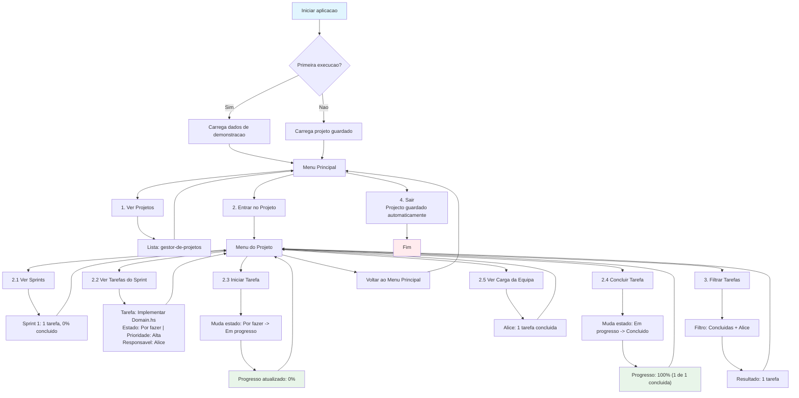

# gestor-de-projetos


## 2. Problema

Equipas pequenas de desenvolvimento de software gerem frequentemente os seus projetos através de folhas de cálculo, listas dispersas ou ferramentas demasiado pesadas para o contexto. Isto dificulta a visão consolidada do estado das tarefas, a priorização, a deteção de bloqueios e a medição do progresso por sprint.

O **gestor-de-projetos** pretende resolver este problema oferecendo uma aplicação de linha de comandos, em Haskell, que permite modelar projetos, tarefas e sprints, aplicar regras de negócio explícitas (transições de estado, prioridades, dependências) e gerar relatórios úteis para a equipa.

---

## 3. Objetivos

- Modelar o domínio de gestão de projetos com tipos algébricos próprios e records claros.
- Implementar um núcleo funcional puro que concentre toda a lógica de domínio (criação, transição de estados, filtragem, agregação, deteção de bloqueios).
- Tratar explicitamente situações de ausência e erro com `Maybe` e `Either`.
- Persistir o estado da aplicação num formato simples (ficheiro de texto/CSV/JSON próprio).
- Disponibilizar uma interface de terminal simples e previsível.
- Demonstrar de forma natural os conceitos da UC: recursão, pattern matching, HOF, `map`/`filter`/`fold`, composição, modularização e testes.

---

## 4. Utilizadores

| Utilizador | Contexto de utilização |
|---|---|
| **Gestor de projeto** | Cria projetos e sprints, define prioridades, acompanha progresso e gera relatórios. |
| **Developer / membro da equipa** | Cria e atualiza tarefas, altera estados, adiciona comentários, consulta o seu trabalho atribuído. |
| **Professor / júri** | Utilizador de demonstração: executa o fluxo completo através do menu textual. |

---

## 5. Funcionalidades (versão inicial)

### 5.1 Gestão de entidades
- Criar, listar e consultar **projetos**.
- Criar, listar e consultar **sprints** associados a um projeto.
- Criar, listar e consultar **tarefas** associadas a um sprint.
- Atribuir tarefas a membros da equipa.

### 5.2 Regras de domínio
- Transição de estados de tarefa com validação (`ToDo → InProgress → Review → Done`, com regras explícitas).
- Cálculo de prioridade efetiva (prioridade base + proximidade do prazo).
- Deteção de tarefas **bloqueadas** (dependências não concluídas).
- Cálculo de progresso de sprint e de projeto (percentagem de tarefas concluídas, pontos, etc.).

### 5.3 Consulta e filtragem
- Filtrar tarefas por estado, prioridade, responsável ou sprint.
- Pesquisar tarefas por texto no título/descrição.
- Listar tarefas atribuídas a um membro.

### 5.4 Relatórios
- Relatório de sprint: tarefas por estado, progresso, tarefas bloqueadas.
- Relatório de projeto: progresso global, distribuição por prioridade.
- Relatório de membro: carga de trabalho e tarefas em curso.

### 5.5 Persistência e IO
- Carregar estado a partir de ficheiro no arranque.
- Guardar estado após alterações.
- Menu textual com operações organizadas por área.

### 5.6 Testes
- Testes das funções puras principais: transições de estado, cálculo de progresso, filtros combinados, deteção de bloqueios, parsing e validação.

---

## 6. Dados de Teste e Validação da Fase 1

O projeto inclui um conjunto de dados de demonstração em `data/seed.hs` com:

- 1 projeto principal
- 2 sprints distintos
- 9 tarefas com estados, prioridades e dependências variadas
- 4 membros da equipa

Estes dados permitem testar cenários reais de:

- consulta por ID
- cálculo de progresso por sprint e por projeto
- tarefas bloqueadas por dependências
- filtros por estado, responsável e prioridade
- transições aplicáveis e inválidas

A documentação complementar está disponível em:

- `docs/dados_teste.md`
- `docs/guiao_fase1.md`

A suite HUnit em `test/Spec.hs` pode ser executada com `cabal test`. Cobre consultas por ID (incluindo resultados inexistentes), filtros, transições, progresso de sprint/projeto (incluindo listas vazias) e bloqueios por dependências concluídas, pendentes ou inexistentes.

---

## 7. Exemplo de Fluxo Padrão da Aplicação (baseado no `data/seed.hs`)

O diagrama abaixo ilustra a jornada do utilizador (Gestor ou Developer) quando a aplicacao estiver completa (Fase 3), num cenario simples: 1 projeto, 1 sprint, 1 tarefa.



### Legenda do Fluxo

| Cor | Significado |
|-----|-------------|
| Azul | Inicio / carregamento |
| Vermelho | Fim / saida |
| Verde | Accao concluida com sucesso |

---

## 8. Entrada / Saída

| Tipo | Descrição |
|---|---|
| **Entrada** | Menu textual no terminal (opções numéricas), dados introduzidos pelo utilizador (títulos, prioridades, IDs). |
| **Ficheiros** | Ficheiro de estado (ex.: `data/state.txt` ou `data/state.json`) com a serialização da lista de projetos. Ficheiro de dados de demonstração (`data/seed.*`). |
| **Saída** | Listagens formatadas no terminal, relatórios em texto, mensagens de erro claras (`Either`). |
| **Formato de persistência** | Formato simples e legível (texto estruturado ou CSV próprio), com parsing explícito e validação. |

---

## 9. Componente Funcional — Conceitos da UC explorados

| Conceito | Onde aparece no projeto |
|---|---|
| **ADTs e records** | `TaskStatus`, `Priority`, `Member`, `Task`, `Sprint`, `Project`. |
| **Pattern matching** | Transições de estado, formatação de relatórios, parsing. |
| **Recursão** | Percorrer listas de projetos/sprints/tarefas, deteção de dependências (possivelmente recursiva), cálculo de progresso. |
| **Funções de ordem superior** | Filtros combináveis de tarefas, critérios de ordenação, funções de transformação de relatórios. |
| **`map` / `filter` / `fold`** | Pipelines de consulta, agregações de progresso, geração de relatórios. |
| **Composição** | Pipelines de filtragem e formatação; composição de predicados. |
| **`Maybe`** | Pesquisa de tarefas/projetos por ID; tarefa sem responsável. |
| **`Either`** | Validação de transições de estado inválidas, criação de entidades com dados inválidos, parsing de ficheiros. |
| **IO separado do núcleo** | Módulo `Domain` puro; módulo `Main`/`IO` apenas para interação e persistência. |
| **Modularização** | `Model`, `Domain`, `Parsing`, `Persistence`, `Reports`, `Main`. |
| **Testes** | Testes das funções puras com casos normais, limites e erros. |


## 10. Plano de Desenvolvimento por Fases (alinhado com o framework)

### Fase 1 — Modelação e núcleo funcional
- Definir `Model.hs` com ADTs e records principais.
- Estrutura inicial do repositório e módulos.
- Funções puras essenciais: criação de entidades, listagem, pesquisa por ID, cálculo simples de progresso.
- Recursão justificada: percorrer projetos/sprints/tarefas, cálculo de progresso.
- Dados de teste pequenos (`data/seed.*`).
- `README.md` inicial e histórico Git.

### Fase 2 — Lógica funcional e transformação de dados
- Implementar a maioria da lógica de domínio: transições de estado, prioridade efetiva, deteção de bloqueios.
- Introduzir HOF, pipelines com `map`/`filter`/`fold` e composição.
- Tratamento explícito com `Maybe`/`Either`.
- Testes de casos normais, limites e erros.
- Separação crescente entre lógica funcional e IO.
- Atualização de README e documentação.

### Fase 3 — Aplicação final, apresentação e defesa
- Aplicação integrada e executável com menu textual.
- Leitura/escrita de ficheiros integradas com parsing e validação seguros.
- Relatórios completos.
- Modularização final (`Model`, `Domain`, `Parsing`, `Persistence`, `Reports`, `Main`).
- Conjunto de testes das funcionalidades principais.
- `README.md` final e relatório técnico.

---

## 11. Estrutura de Repositório Prevista

```
gestor-de-projetos/
├── README.md
├── gestor-de-projetos.cabal
├── cabal.project
├── src/
│   ├── Model.hs
│   ├── Domain.hs
│   ├── Parsing.hs
│   ├── Persistence.hs
│   └── Reports.hs
├── app/
│   └── Main.hs
├── test/
│   └── Spec.hs
├── data/
│   └── seed.txt
└── docs/
    └── relatorio.pdf
```