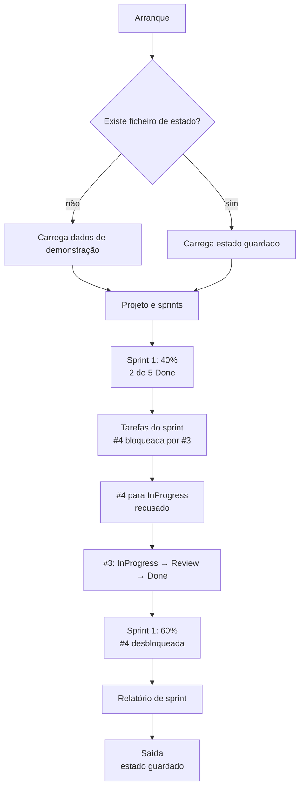

# gestor-de-projetos

## 1. Problema

Equipas pequenas organizam os projetos em folhas de cálculo e listas soltas. Quando o trabalho cresce, deixa de ser possível ver ao mesmo tempo o estado das tarefas, a prioridade de cada uma, o que está bloqueado à espera de outra tarefa e quanto já avançou o sprint.

O **gestor-de-projetos** é uma aplicação de linha de comandos, escrita em Haskell, que junta essa informação num sítio só. Guarda projetos, sprints e tarefas e aplica as regras que a equipa define sobre eles: em que estado pode entrar uma tarefa, que prioridade tem, de que outras tarefas depende. A partir daí, mostra o estado do trabalho em relatórios de sprint, de projeto e de membro.

## 2. Objetivos

- Modelar o domínio de gestão de projetos com tipos algébricos próprios e records claros.
- Implementar um núcleo funcional puro que concentre toda a lógica de domínio (criação, transição de estados, filtragem, agregação, deteção de bloqueios).
- Tratar explicitamente situações de ausência e erro com `Maybe` e `Either`.
- Persistir o estado da aplicação num formato simples (ficheiro de texto/CSV/JSON próprio).
- Disponibilizar uma interface de terminal simples e previsível.
- Demonstrar de forma natural os conceitos da UC: recursão, pattern matching, HOF, `map`/`filter`/`fold`, composição, modularização e testes.

## 3. Funcionalidades

> **Nota:** esta lista descreve o âmbito completo do projeto. Na Fase 1 está implementado apenas o subconjunto descrito na secção 6: modelo de domínio, consultas, listagens, filtros, progresso e deteção de bloqueios. Tudo o resto está marcado como Fase 2/3.

### 3.1 Gestão de entidades
- Criar, listar e consultar **projetos**.
- Criar, listar e consultar **sprints** associados a um projeto.
- Criar, listar e consultar **tarefas** associadas a um sprint.
- Atribuir tarefas a membros da equipa.

### 3.2 Regras de domínio
- Transição de estados de tarefa com validação (`ToDo → InProgress → Review → Done`, com regras explícitas).
- Cálculo de prioridade efetiva (prioridade base + proximidade do prazo).
- Deteção de tarefas **bloqueadas** (dependências não concluídas).
- Cálculo de progresso de sprint e de projeto (percentagem de tarefas concluídas, pontos, etc.).

### 3.3 Consulta e filtragem
- Filtrar tarefas por estado, prioridade, responsável ou sprint.
- Pesquisar tarefas por texto no título/descrição.
- Listar tarefas atribuídas a um membro.

### 3.4 Relatórios
- Relatório de sprint: tarefas por estado, progresso, tarefas bloqueadas.
- Relatório de projeto: progresso global, distribuição por prioridade.
- Relatório de membro: carga de trabalho e tarefas em curso.

### 3.5 Persistência e IO
- Carregar estado a partir de ficheiro no arranque.
- Guardar estado após alterações.
- Menu textual com operações organizadas por área.

### 3.6 Testes
- Testes das funções puras principais: transições de estado, cálculo de progresso, filtros combinados, deteção de bloqueios, parsing e validação.

## 4. Exemplo de fluxo

Este exemplo descreve a utilização prevista para a Fase 3, sobre os dados de demonstração (`data/Seed.hs`), que têm dois sprints. As regras que aparecem no percurso já estão implementadas no núcleo; falta a interface que as põe a funcionar.



1. Ao arrancar, a aplicação procura o ficheiro de estado. Se ainda não existir, carrega os dados de demonstração.
2. O utilizador escolhe o projeto `gestor-de-projetos` e vê os dois sprints. O Sprint 1 está a 40%, porque duas das cinco tarefas já estão `Done`. O Sprint 2 está a 0%.
3. Dentro do Sprint 1 pede a lista de tarefas. Cada linha mostra o título, o estado, a prioridade e o responsável. A tarefa `Escrever testes` aparece marcada como bloqueada: depende de `Implementar Domain.hs`, que ainda está `InProgress`.
4. Tenta avançar `Escrever testes` para `InProgress`. A aplicação recusa, porque a dependência não está concluída.
5. Volta a `Implementar Domain.hs` e conduz o estado até ao fim: `InProgress` → `Review` → `Done`. O progresso do sprint passa a 60%.
6. `Escrever testes` deixa de estar bloqueada e já aceita a transição para `InProgress`.
7. Pede o relatório de sprint e vê a contagem por estado, a percentagem concluída e a lista de tarefas bloqueadas.
8. Sai. A aplicação guarda o estado no ficheiro, para a execução seguinte continuar daqui.

A regra de transição recusa saltos (`ToDo` → `Done`) e recuos (`Review` → `InProgress`), e a mensagem de erro indica qual foi a transição pedida.

## 5. Componente funcional

| Conceito | Onde aparece no projeto |
|---|---|
| **ADTs e records** | `TaskStatus`, `Member`, `Task`, `Sprint`, `Project`. A prioridade é um `Int` entre 1 e 4. |
| **Pattern matching** | Transições de estado, formatação de relatórios, parsing. |
| **Recursão** | Percorrer listas de projetos/sprints/tarefas, deteção de dependências (possivelmente recursiva), cálculo de progresso. |
| **Funções de ordem superior** | Fase 2: filtros combináveis e critérios de ordenação. |
| **`map` / `filter` / `fold`** | Fase 1: `filter` em `filterByStatus`/`filterByPriority`/`filterByAssignee`. Fase 2: pipelines e `fold`. |
| **Composição** | Fase 2: pipelines de filtragem e formatação. |
| **`Maybe`** | Pesquisa de tarefas/projetos/sprints/membros por ID; tarefa sem responsável. |
| **`Either`** | Fase 2: validação de transições de estado e criação de entidades; Fase 3: parsing de ficheiros. |
| **IO separado do núcleo** | Módulo `Domain` puro; módulo `Main`/`IO` apenas para interação e persistência. |
| **Modularização** | `Model`, `Domain`, `Parsing`, `Persistence`, `Reports`, `Main`. |
| **Testes** | Testes das funções puras com casos normais, limites e erros. |

## 6. Plano de desenvolvimento por fases

### Fase 1: modelação e núcleo funcional (concluída)
- Definir `Model.hs` com ADTs e records principais.
- Estrutura inicial do repositório e módulos (`Parsing`, `Persistence`, `Reports` como stubs com assinaturas).
- Funções puras essenciais: consultas por ID, listagens, filtros, cálculo de progresso e deteção de bloqueios.
- Recursão justificada: `progressSprint`, `progressProject`, `isBlocked`.
- Dados de teste pequenos (`data/Seed.hs`) e suite HUnit (`test/Spec.hs`).
- `README.md`, `docs/modelo.md`, `docs/dados_teste.md`, `docs/guiao_fase1.md` e histórico Git.

### Fase 2: lógica funcional e transformação de dados
- Implementar a maioria da lógica de domínio: transições de estado, prioridade efetiva, deteção de bloqueios.
- Introduzir HOF, pipelines com `map`/`filter`/`fold` e composição.
- Tratamento explícito com `Maybe`/`Either`.
- Testes de casos normais, limites e erros.
- Separação crescente entre lógica funcional e IO.
- Atualização de README e documentação.

### Fase 3: aplicação final, apresentação e defesa
- Aplicação integrada e executável com menu textual.
- Leitura/escrita de ficheiros integradas com parsing e validação seguros.
- Relatórios completos.
- Modularização final (`Model`, `Domain`, `Parsing`, `Persistence`, `Reports`, `Main`).
- Conjunto de testes das funcionalidades principais.
- `README.md` final e relatório técnico.

## 7. Estrutura do repositório prevista

```
gestor-de-projetos/
├── README.md
├── gestor-de-projetos.cabal
├── cabal.project
├── src/
│   ├── Model.hs        -- tipos de domínio
│   ├── Domain.hs       -- núcleo funcional puro (Fases 1 e 2)
│   ├── Parsing.hs      -- stub (Fase 3)
│   ├── Persistence.hs  -- stub (Fase 3)
│   └── Reports.hs      -- stub (formatação na Fase 2)
├── app/
│   └── Main.hs         -- ponto de entrada mínimo
├── test/
│   └── Spec.hs         -- suite HUnit (29 casos)
├── data/
│   └── Seed.hs         -- dados de demonstração (compilados com os testes)
└── docs/
    ├── modelo.md
    ├── dados_teste.md
    ├── documentacao_fase2.md
    ├── guiao_fase1.md
    ├── plano_fase1.md
    └── plano_fase2.md
```
