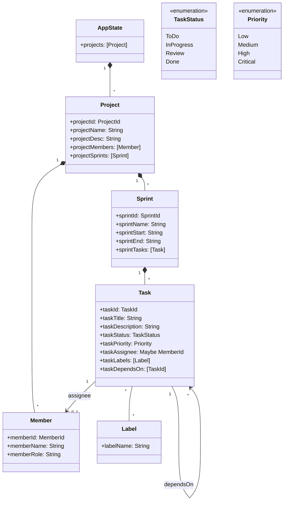

# Documentação do Modelo de Domínio

## 1. Visão Geral

O modelo de domínio do **gestor-de-projetos** representa um sistema de gestão de projetos de desenvolvimento de software com sprints, tarefas, membros e etiquetas. A modelação segue os princípios da programação funcional: tipos de soma para estados finitos, records para entidades, `Maybe` para opcionalidade e listas para relações 1:N.

## 2. Diagrama de Entidades (Mermaid)



## 3. Definição dos Tipos

### 3.1 Identificadores (Type Synonyms)

```haskell
type ProjectId = Int
type SprintId  = Int
type TaskId    = Int
type MemberId  = Int
```

**Justificativa:** Type synonyms dão semântica aos `Int` puros, facilitando a leitura de assinaturas de funções sem overhead de runtime. Não usamos `newtype` para manter simplicidade na Fase 1; pode ser evoluído na Fase 2/3 para type safety mais forte.

### 3.2 TaskStatus (Sum Type)

```haskell
data TaskStatus = ToDo | InProgress | Review | Done
  deriving (Eq, Show, Read, Enum, Bounded, Ord)
```

**Justificativa:**
- **Sum type** modela máquina de estados finita com 4 estados bem definidos
- **Ord derivado** permite ordenação natural: `ToDo < InProgress < Review < Done`
- **Enum/Bounded** permitem iteração e validação de limites
- Transições válidas codificadas em `Domain.validTransitions` (não no tipo, para flexibilidade)

### 3.3 Priority (Sum Type)

```haskell
data Priority = Low | Medium | High | Critical
  deriving (Eq, Show, Read, Enum, Bounded, Ord)
```

**Justificativa:**
- **Ord derivado** essencial para comparação de prioridade (ex.: `High > Medium`)
- **Enum/Bounded** para iteração e validação
- Ordem semântica natural: `Low < Medium < High < Critical`

### 3.4 Member (Record)

```haskell
data Member = Member
  { memberId   :: MemberId
  , memberName :: String
  , memberRole :: String
  } deriving (Eq, Show, Read)
```

**Justificativa:**
- Record com campos nomeados para clareza e pattern matching por campo
- `memberRole` permite distinguir funções (Developer, QA, PO, etc.)
- Sem `Ord` — membros não têm ordem natural

### 3.5 Label (Record)

```haskell
data Label = Label
  { labelName :: String
  } deriving (Eq, Show, Read)
```

**Justificativa:**
- Wrapper simples para string com semântica de domínio
- Lista `[Label]` em `Task` permite múltiplas etiquetas por tarefa
- `Eq`/`Show` para comparação e exibição

### 3.6 Task (Record Principal)

```haskell
data Task = Task
  { taskId          :: TaskId
  , taskTitle       :: String
  , taskDescription :: String
  , taskStatus      :: TaskStatus
  , taskPriority    :: Priority
  , taskAssignee    :: Maybe MemberId
  , taskLabels      :: [Label]
  , taskDependsOn   :: [TaskId]
  } deriving (Eq, Show, Read)
```

**Justificativa:**
- **Maybe MemberId**: tarefa pode não ter responsável atribuído
- **[Label]**: zero ou mais etiquetas
- **[TaskId]**: dependências por ID (não referências diretas) — evita ciclos na estrutura de dados e permite serialização simples
- **Sem `Ord`**: tarefas não se comparam naturalmente

### 3.7 Sprint (Record)

```haskell
data Sprint = Sprint
  { sprintId     :: SprintId
  , sprintName   :: String
  , sprintStart  :: String   -- ISO 8601: YYYY-MM-DD
  , sprintEnd    :: String
  , sprintTasks  :: [Task]
  } deriving (Eq, Show, Read)
```

**Justificativa:**
- Datas como `String` no formato ISO 8601 — simplicidade na Fase 1; pode evoluir para `Day` (time) na Fase 2/3
- Lista de tarefas embutida — agregação por valor (não referências)

### 3.8 Project (Record Raiz)

```haskell
data Project = Project
  { projectId     :: ProjectId
  , projectName   :: String
  , projectDesc   :: String
  , projectMembers :: [Member]
  , projectSprints :: [Sprint]
  } deriving (Eq, Show, Read)
```

**Justificativa:**
- Agrega membros e sprints — entidade raiz do agregado
- Permite consultas transversais (ex.: todas as tarefas de um membro no projeto)

### 3.9 AppState (Estado Global)

```haskell
data AppState = AppState
  { projects :: [Project]
  } deriving (Eq, Show, Read)
```

**Justificativa:**
- Estado global único — lista de projetos
- Simplicidade: um ficheiro de persistência = um `AppState`
- Extensível: pode adicionar `currentProjectId`, configurações, etc.

## 4. Relações e Navegação

| Relação | Tipo | Navegação |
|---------|------|-----------|
| Project → Sprints | 1:N | `projectSprints :: Project -> [Sprint]` |
| Project → Members | 1:N | `projectMembers :: Project -> [Member]` |
| Sprint → Tasks | 1:N | `sprintTasks :: Sprint -> [Task]` |
| Task → Assignee | 0:1 | `taskAssignee :: Task -> Maybe MemberId` |
| Task → Labels | 0:N | `taskLabels :: Task -> [Label]` |
| Task → DependsOn | 0:N | `taskDependsOn :: Task -> [TaskId]` |

**Decisão:** Usar IDs (`TaskId`, `MemberId`) em vez de referências diretas (`Task`, `Member`) nas relações:
- ✅ Serialização trivial (JSON/texto simples)
- ✅ Evita ciclos na estrutura de dados em memória
- ✅ Permite carregamento preguiçoso/parcial
- ❌ Requer lookups (`findTask`, `findMember`) — resolvido com funções em `Domain`

## 5. Decisões de Modelação Relevantes

### 5.1 Por que `Maybe` e não `Either` nos campos?
- `Maybe MemberId`: ausência de responsável é um estado normal, não erro
- `Either` reservado para validação de entrada (smart constructors) e parsing

### 5.2 Por que não `newtype` para IDs?
- Fase 1: simplicidade, foco em ADTs de domínio
- Fase 2/3: pode introduzir `newtype ProjectId = ProjectId Int` com `SmartConstructor` para type safety

### 5.3 Por que datas como `String`?
- Evita dependência de `time` na Fase 1
- ISO 8601 (`YYYY-MM-DD`) é legível, ordenável lexicograficamente e parsável
- Migração para `Day` é localizada em `Parsing` e `Persistence`

### 5.4 Derivações padrão (`Eq`, `Show`, `Read`)
- `Eq`: necessário para testes e comparações em filtros
- `Show`: debugging, logs, relatórios textuais
- `Read`: parsing simples em `Parsing` (formato Haskell nativo)
- `Enum`/`Bounded`: apenas em sum types finitos (`TaskStatus`, `Priority`)

### 5.5 Smart Constructors em `Domain`
- Validação centralizada: `mkProject`, `mkTask`, etc. retornam `Either String`
- Garante que entidades inválidas não existem no núcleo puro
- `Domain` exporta apenas smart constructors, não construtores de record

## 6. Extensibilidade Prevista (Fase 2/3)

| Extensão | Local | Impacto |
|----------|-------|---------|
| `newtype` para IDs | `Model.hs` | Quebra compatibilidade binária; requer migração |
| `Day` para datas | `Model.hs`, `Parsing.hs` | Requer `time` dependency |
| Comentários em tarefas | `Task` record | Novo campo `taskComments :: [Comment]` |
| Anexos/ficheiros | `Task` ou novo tipo | Novo módulo `Attachments` |
| Histórico de mudanças | Novo tipo `Event` | Event sourcing / audit log |
| Permissões/roles | `Member` + novo tipo | Módulo `Auth` |

## 7. Resumo das Typeclasses Derivadas

| Tipo | Eq | Show | Read | Enum | Bounded | Ord |
|------|:--:|:----:|:----:|:----:|:-------:|:---:|
| TaskStatus | ✓ | ✓ | ✓ | ✓ | ✓ | ✓ |
| Priority | ✓ | ✓ | ✓ | ✓ | ✓ | ✓ |
| Member | ✓ | ✓ | ✓ |   |   |   |
| Label | ✓ | ✓ | ✓ |   |   |   |
| Task | ✓ | ✓ | ✓ |   |   |   |
| Sprint | ✓ | ✓ | ✓ |   |   |   |
| Project | ✓ | ✓ | ✓ |   |   |   |
| AppState | ✓ | ✓ | ✓ |   |   |   |

---

*Documento gerado para a Fase 1 — Modelação e Estrutura do Projeto*
*Elemento A (Francisco) — Responsável pelo modelo de domínio*